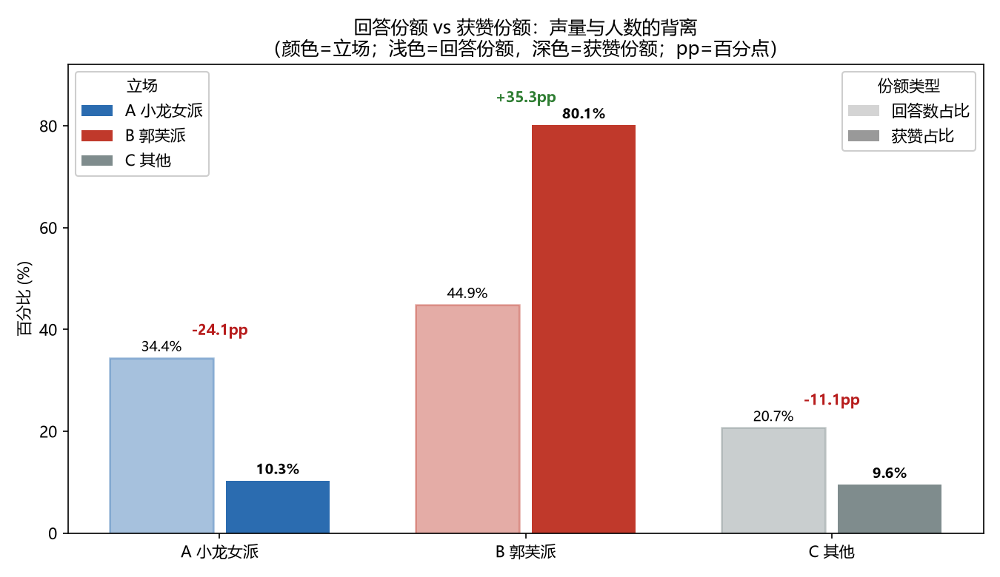
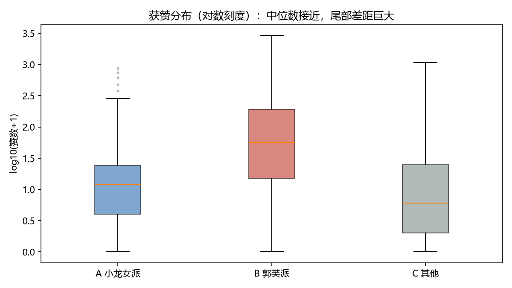
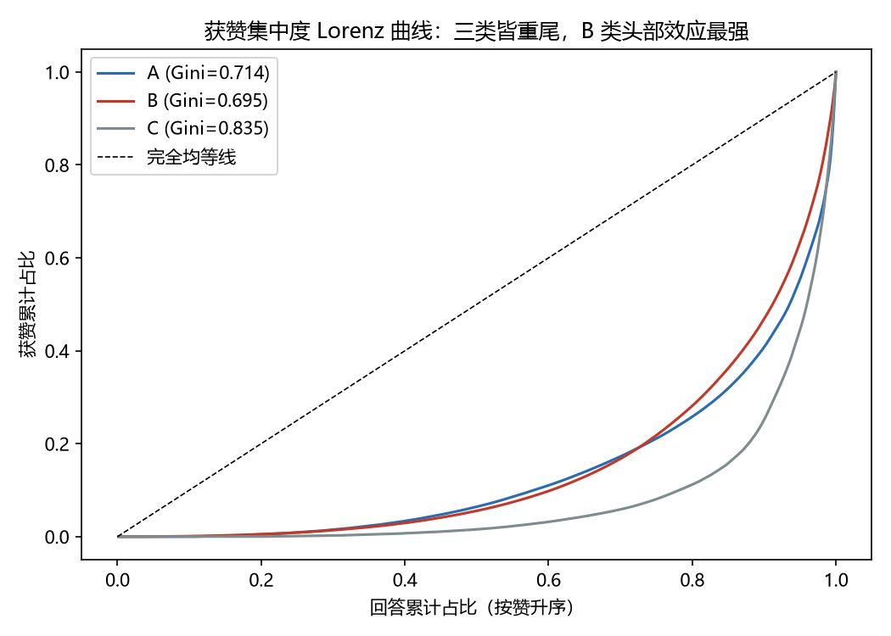
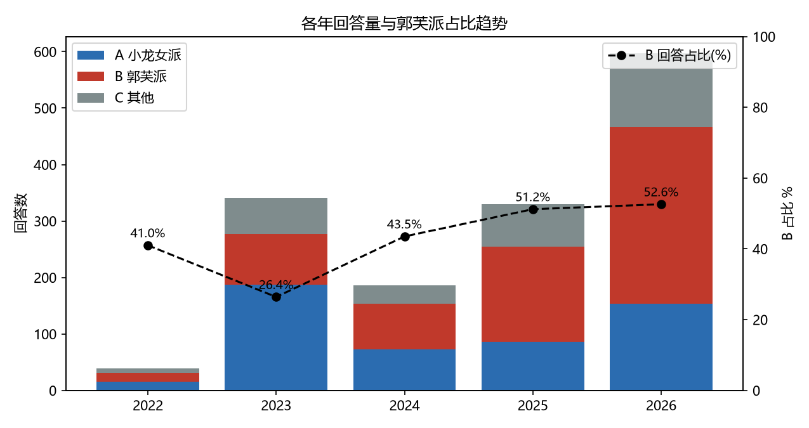
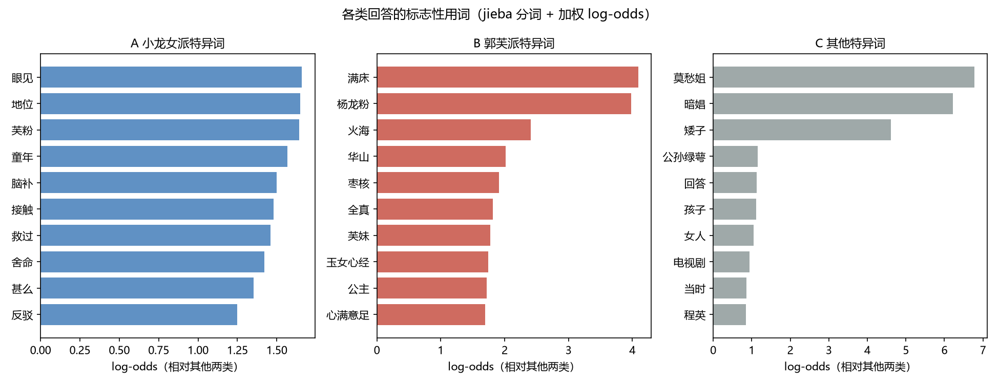

# 知乎"杨过爱谁"争论统计报告与深度分析

**数据范围**：知乎 4 个问题下全部公开回答——《你为什么认为杨过爱郭芙？》《为什么金庸去世以后冒出很多杨过暗恋郭芙的言论？》《杨过到底喜欢郭芙还是小龙女？》《男生角度，杨过爱的是小龙女还是郭芙？》
**抓取时间**：2026 年 11 月 18 日｜**样本量**：1493 条回答，140,471 个赞，1137 位独立作者
**分析方法**：内容分析 + 描述统计 + 推断检验（卡方/秩和检验/bootstrap）+ 时间序列分析 + 文本挖掘（分词、加权 log-odds）+ 集中度分析（Gini/Lorenz）
**姊妹篇**：学术论文《〈神雕侠侣〉杨过情感归属之争的四层嵌套因果模型与实证研究》（理论分析详见该文）｜**机器可读指标**：`data/analysis_metrics.json`

---

# 第一部分　数据分析报告

## 1. 方法、数据与分类口径

对每条回答按主要论点做三分类编码：

| 代号 | 含义 | 判定要点 |
|---|---|---|
| A | 小龙女派 | 认为杨过真正爱的是小龙女（含"对郭芙只是自卑/讨厌/执念"） |
| B | 郭芙派（过芙党） | 认为杨过真正爱的是郭芙（含"暗恋郭芙""表面爱龙实际爱芙""对龙只是孺慕/恩情"） |
| C | 其他 | 问题不成立、谁都不爱/爱自己/爱郭襄、纯玩梗、无立场、两派都批、骑墙 |

口径说明：以最终结论为准，识别反串；批评杨龙恋而未否定过芙说的按主要倾向归 B；过短无立场归 C。全部 1493 条逐条判定并程序化校验（覆盖率 100%）。逐条标注见 `data/all_answers_classified.csv`，交互浏览见 `viewer/index.html`。

## 2. 总体统计

| 立场 | 回答数 | 占比（95% CI） | 获赞数 | 赞占比（95% CI） | 平均单答获赞 | 赞中位数 |
|---|---|---|---|---|---|---|
| A 小龙女派 | 514 | 34.4% | 14,497 | 10.3% | 28.2 | **11** |
| **B 郭芙派** | **670** | **44.9%**（42.4–47.4） | **112,558** | **80.1%**（75.9–83.9） | **168.0** | **55** |
| C 其他 | 309 | 20.7% | 13,416 | 9.6% | 43.4 | 5 |
| 合计 | 1493 | 100% | 140,471 | 100% | 94.1 | 20 |

（B 回答占比的 Wilson 95% 置信区间 42.4–47.4%；B 赞占比经 10000 次 bootstrap 重抽样的 95% CI 为 75.9–83.9%——**两个核心结论在抽样误差意义上稳健**。）

**一句话总结**：论"人数"四四开，论"人心"八二开——郭芙派的回答数是杨龙派的 1.3 倍，获赞是 7.8 倍；且**典型**回答的获赞是杨龙派的 5 倍（中位数 55 vs 11），说明优势不是靠个别爆款，而是分布整体右移。

## 3. 分问题统计

| 问题（设问） | 回答数 | A 数/赞 | B 数/赞 | C 数/赞 | B 赞占比 |
|---|---|---|---|---|---|
| 《你为什么认为杨过爱郭芙？》 | 514 | 127 / 4,495 | 295 / 57,185 | 92 / 5,624 | 84.9% |
| 《为什么金庸去世以后冒出很多杨过暗恋郭芙的言论？》 | 140 | 52 / 994 | 54 / 5,425 | 34 / 1,578 | 67.8% |
| 《杨过到底喜欢郭芙还是小龙女？》 | 440 | 171 / 4,386 | 188 / 32,787 | 81 / 2,894 | 81.8% |
| 《男生角度，杨过爱的是小龙女还是郭芙？》 | 399 | 164 / 4,622 | 133 / 17,161 | 102 / 3,320 | 68.4% |

要点：
- **四个问题无一例外**，郭芙派赞占比 ≥ 67.8%——不是单题"提纯"效应，是稳定趋势。
- **设问的框架效应**：《你为什么认为杨过爱郭芙？》预设前提，天然聚集认同者，故该题过芙浓度最高（57% 回答、85% 赞）；《男生角度，杨过爱的是小龙女还是郭芙？》中立设问且限定"男生角度"，杨龙派在该题回答数占优（164 vs 133）。**回答数受题目措辞影响大，赞数分布相对稳定**。
- 《男生角度，杨过爱的是小龙女还是郭芙？》虽是唯一杨龙派回答数占优的题，赞数仍以 18.4% 对 68.3% 落后：杨龙派的典型处境——**说得不少，认同不多**。

## 4. 统计推断：结论的稳健性检验

| 检验 | 假设 | 结果 | 解读 |
|---|---|---|---|
| 卡方独立性检验 | 立场分布与提问无关 | χ²=62.1, df=6, p≈1.7×10⁻¹¹, Cramér's V=0.144 | 设问框架效应**统计显著但效应量小**：不同题目的立场构成确有差异，但主体格局稳定 |
| Mann-Whitney U | A、B 赞数同分布 | U=82263, p≈1.1×10⁻⁵³, 秩二列相关=0.522 | B 赞数显著高于 A，**大效应量**，非抽样偶然 |
| Kruskal-Wallis | 三类赞数同分布 | H=322.9, p≈7.6×10⁻⁷¹ | 三类获赞结构显著不同 |
| Bootstrap（10000 次） | B 赞占比 | 95% CI 75.9–83.9% | "80%" 稳健，置信区间不与 A 的量级重叠 |

方法论注记：赞数为重尾分布，故均值类检验（t 检验）不适用，本报告统一采用**非参数检验**；效应量（Cramér's V、秩二列相关）与 p 值并报，避免大样本下"显著性通胀"。结论：**"郭芙派占优"及其量级不因抽样、题目构成或检验方法而翻转**。

## 5. 获赞分布与集中度分析

| 指标 | A 小龙女派 | B 郭芙派 | C 其他 |
|---|---|---|---|
| 赞中位数 | 11 | **55** | 5 |
| 赞四分位距（Q1–Q3） | 3–23 | 14–193 | 1–24 |
| 赞 P90 | 60 | 425 | 127 |
| 赞最高值 | 863 | 2926 | 1077 |
| Gini 系数 | 0.714 | 0.695 | **0.835** |
| Top 10% 回答占本类赞比 | 59.9% | 53.1% | 74.9% |
| ≤5 赞的"沉底"回答 | 186 条（36%） | 82 条（12%） | 159 条（51%） |
| 均值/中位数比 | 2.6 | 3.1 | 8.7 |

三个发现：
1. **B 的优势是"全分布"的**：不仅头部爆款多，中位数（55 vs 11）、四分位、P90 全面领先；"沉底率"仅 12%，而 A 有 36% 的回答不足 5 赞。Mann-Whitney 的大效应量（0.522）正是对此的检验。
2. **A 派是"橄榄型"，C 类是"倒丁字型"**：C 类 Gini 高达 0.835、均值/中位数比 8.7——玩梗类回答大多沉底，偶尔一条爆到 1077 赞，典型的"彩票型"分布。
3. **三类皆重尾**：Top 10% 回答吃掉 53–75% 的赞，这是社交媒体声量的普遍规律，也再次提醒赞数≠人数（见第 10 节）。

## 6. 时间趋势：过芙说正在赢得时间

各年回答量与 B 占比（按回答创建时间）：

| 年份 | 总回答 | A | B | C | B 占比 |
|---|---|---|---|---|---|
| 2022 | 39 | 15 | 16 | 8 | 41.0% |
| 2023 | 341 | 187 | 90 | 64 | **26.4%** |
| 2024 | 186 | 73 | 81 | 32 | 43.5% |
| 2025 | 330 | 86 | 169 | 75 | **51.2%** |
| 2026（至 11 月） | 597 | 153 | 314 | 130 | **52.6%** |

- **趋势线清晰**：B 占比从 2023 年的 26.4% 一路升至 2026 年的 52.6%——过芙说不仅存量占优，**增量上正在胜出**，已从"少数派考据"变成"主流叙事之一"。
- **逐年中位数稳健**：即使控制"新回答攒赞时间短"的年龄效应（2026 年各家中位数普遍回落），**B 的赞中位数在每一个年份都高于 A**（2023: 69 vs 14；2024: 132 vs 14；2025: 103 vs 8），说明赞差不是"早年爆款"造成的，而是持续存在的偏好。
- 2023 年 A 占比最高（55%），与当时"反驳过芙说"的集中产出有关；此后攻守易位。样本量注记：2022 年仅 39 条（问题新立），比例波动大，趋势主要由 2023 年后数据支撑。

## 7. 文本特征挖掘：两派的"武器库"实证

对 1493 条回答全文做 jieba 分词，以加权 log-odds 提取各类**相对其他两类的特异用词**（词频 ≥25）：

**B 郭芙派的特异词**（细节考据的证据链语言）：
`满床`（满床笏典故）、`杨龙粉`、`火海`（救人场景）、`华山`、`枣核`（枣核钉）、`全真`、**`芙妹`（出现 205 次，log-odds 1.78）**、`玉女心经`、`公主`、**`心满意足`（战场对拜原句）**、`绝恋`、`情若`（情若兄妹）、`亲热`、`面具`、`错过`。
→ 实证了第 4 节的判断：过芙派的论证武器是**具体场景、原文关键词、道具级细节**——"芙妹""心满意足""情若兄妹"这类原文字眼本身就是他们的论据。特异词第一名 `满床`（满床笏）属典故索隐，对应其"暗线考据"流派。

**A 小龙女派的特异词**（反驳与整体叙事语言）：
`眼见`、`地位`、**`芙粉`（指称对手）**、`童年`、**`脑补`（方法论批判）**、`接触`、`救过`、`舍命`、`甚么`、**`反驳`**、`好感`、`失踪`、`复仇`（断臂之仇）、`解读`。
→ 杨龙派的话语结构是**论战性、反驳性**的：高频词是"脑补""反驳""解读"——他们的主要动作是"拆解对方"而非"陈列证据"，这与"人多赞少"的守成姿态互相印证。

**C 其他的特异词**：`莫愁姐`、`公孙绿萼`、`程英`、`电视剧`、`女人`、`男人`、`角色`——话题向其他角色、媒介改编和性别议题发散，坐实其"借题发挥"的旁观者生态。

## 8. 写作特征、争议指数与作者生态

**篇幅—获赞关系（Spearman 秩相关）**：

| 类别 | 篇幅-赞相关 ρ | p 值 | 平均篇幅 | 解读 |
|---|---|---|---|---|
| A | **0.297** | <0.001 | 627 字 | 写得越长越容易获赞——**论证型写作**有效 |
| B | **0.054** | 0.165（不显著） | 571 字 | **篇幅与获赞无关**——靠观点共鸣与金句取胜 |
| C | 0.238 | <0.001 | 235 字 | 弱正相关，但平均篇幅最短 |

这组数字很有意思：**杨龙派靠"说理"（长文有效），过芙派靠"共鸣"（长文无用，短兵相接照样拿赞）**。这解释了为何 B 能以相近篇幅拿下 5 倍赞——他们的高赞回答往往是一针见血的心理概括（如"自卑又想显摆，太对味了"），而非文献综述。

**争议指数（评论/赞比）**：A 派 0.592，C 类 0.166，B 派 0.138。杨龙派每 1 赞伴随约 0.6 条评论——其评论区是**论战前线**（反驳者聚集），过芙派评论区则更像**应援现场**。这与 A 派特异词"反驳"高度一致。

**作者生态**：
- 1137 位独立作者产出 1493 条回答；**182 人（16%）跨题作答**，存在一批"论战职业选手"在多个战场重复布防（如"鹿林夕"在两题合计获赞 2975，"微风而来111"跨题获赞 2285）。
- 获赞 Top10 作者合计 24,243 赞（占 17%），头部效应温和，论战并非少数大 V 的独角戏。
- 注：`匿名用户`（56 条）与 `momo`（18 条）为知乎默认马甲昵称，聚合了多个真人，作个体分析时须剔除。

## 9. 双方高赞代表（实录）

**郭芙派 TOP**（作者 / 赞数 / 论点概括）：

| 作者 | 赞 | 核心论点 |
|---|---|---|
| 梅干菜扣肉 | 2926 | 杨过面对郭芙"自卑又想显摆、酸涩、阴阳怪气"的状态暴露真心 |
| whispertu | 2257 | "男生面对看不起自己的班花"的青春心理模型，口嫌体正直 |
| 聪明的钢锁 | 2070 | 原本不信，用初中儿子"越喜欢越作对"的故事完成自我说服 |
| 蛾眉 | 1986 | "嘴上浓情蜜意，行为上拼死救郭芙"的系统文本证据 |
| 鹿林夕 | 1684 | 杨龙相处是"玻璃罩里的真人秀"，爱是自卑、嫉妒、患得患失 |
| 络石 | 1639 | 归谬："官配是小龙女却跟郭芙五五开，你质疑过郭靖爱黄蓉吗？" |
| 铁爷 | 1619 | 方法论口号："不要看一个人怎么说，要看一个人怎么做" |

**杨龙派 TOP**：

| 作者 | 赞 | 核心论点 |
|---|---|---|
| 科维 | 863 | 反讽小品：杨过重生后依然选小龙女 |
| 南荒 | 748 | 以原著细节反驳过芙派引证的场景解读 |
| 阿羊 | 617 | 承认杨龙线写得乏味，但不认同过度解读 |
| 娑罗树下的沙加 | 481 | 原文清单：掌掴、当众拒婚、十六年恨极——"这叫爱？" |
| oforyou | 379 | "非典型杨龙党"：承认喜欢过郭芙，但真爱是小龙女 |
| 狐狸晨曦 | 246 | 男性视角：郭芙从小欺凌到断臂，凭什么爱她 |

**C 类 TOP**：华某龙（1077 赞）"不磕杨龙因为师生恋让我恶心"；momo（885 赞）"女生别拿这个标准找对象"；哟哟哟切克闹（623 赞）"爱不爱都不影响郭芙的人生"；猎人暴怒10.7（505 赞）玩梗"大宋第一男保镖"。

注意高赞结构的不对称：**B 榜单门槛 1619 赞，A 榜单门槛 246 赞**——两派的"王牌部队"不在一个量级上。

## 10. 数据解读的提醒与局限（防误读）

1. **赞 ≠ 人数**：Top 10% 回答吃掉 53–75% 的赞；曝光随赞滚雪球（马太效应）；点赞可能出于"文笔好/有意思"。80%（CI 75.9–83.9%）是"声量结构"，不是公投计票。
2. **样本 ≠ 全体读者**：知乎用户偏年轻、高学历、城市化；爱写长文的人天然聚集。放到 60 后、70 后电视剧观众中抽样，结果可能倒转。时间趋势（B 占比逐年升）在知乎场域内成立，外推须谨慎。
3. **分类有边界**：B/C 界线（"批评杨龙算不算过芙"）影响比例；若把"批评杨龙"单列，B 会降至四成上下，但赞数碾压与趋势结论不变（高赞 B 多为正面立论）。
4. **框架效应真实但小**（Cramér's V=0.144）：预设型问题聚集认同者，跨题比较回答数时须打折；赞数结论稳健。
5. **单人规则编码**，未做双人信度检验；反串文存在误判可能（已尽力识别）。正文截取前 1800 字。
6. **赞的年龄效应**：新回答攒赞时间短，2026 年中位数回落属正常；已用逐年中位数对照排除其对趋势结论的干扰。

---

# 第二部分　深度分析：一场"读小说"引发的战争

## 一、争的到底是什么

表面上争的是"杨过爱谁"，实际上争的是三样东西：**文本怎么读**（细读考据 vs 主线常识）、**爱情是什么**（心动 vs 陪伴，激情 vs 承诺）、**谁的青春更真**（暗恋过的人 vs 初恋即官配的人）。数据里 80% 的赞流向过芙派、B 占比三年从 26% 升到 53%，说明这场战争的重心已经偏移：今天在知乎写回答的年轻人，越来越愿意相信"杨过爱郭芙"这个反直觉的结论。

## 二、两大阵营的武器库（文本挖掘已实证）

**过芙派的四件武器**（第 7 节特异词可作注脚）：

1. **"行为不会说谎"**——断臂不报仇、一次次舍命相救、被郭芙一瞥就失态、战场对拜（特异词"心满意足""情若"即出自此场景）。铁爷的名言"不要看一个人怎么说，要看一个人怎么做"是这一派的宪法。
2. **"重释杨龙"**——把杨龙感情拆解为养育之恩、封闭依赖、被安排的惯性，著名暴论"世界上最伟大的爱就是你妈"（1400 赞）。
3. **暗线考据**——屠龙刀与倚天剑、双雕、`满床笏`典故（特异词第一名）、新修版修改痕迹。最出圈也最富争议的一路。
4. **名家背书**——"陈墨修订新修版后转过芙党""周星驰、宁财神都看出来了"。

**杨龙派的四件武器**（特异词"反驳""脑补""解读"恰是其自我画像）：

1. **主线明写**——十六年苦等、一夜白头、跳崖殉情、后记盖棺。文本事实层的制高点。
2. **归谬与性转**——"砍你胳膊的人你会爱吗""把郭芙性别换一下还爱吗"。
3. **动机祛魅**——救郭芙是侠义、是郭靖黄蓉的面子、是自尊战（特异词"复仇""地位""童年"）。
4. **方法论批判**——拆字、象征、命理是"脑补"，可证明任何结论。

## 三、为什么过芙派拿到了 80% 的赞（分布数据的解释）

不是因为"过芙派更对"，而是五个机制叠加，且每个机制都有数据支撑：

1. **发现感的快感**。反直觉结论自带智识愉悦溢价；杨龙派讲的是人人皆知的主线，没有发现感红利。
2. **生活经验的共鸣**。"越喜欢越欺负""口嫌体正直""白月光"长在读者的共同经验里。第 8 节的数据是关键证据：**B 派篇幅与获赞几乎无关（ρ=0.054）**——他们的高赞靠的是"一句话戳中"，如"自卑又想显摆，太对味了"（2926 赞，全文不到百字量级的概括）。共鸣不需要论证。
3. **考据文体的信息密度**。挑战共识者必须自证，长文清单成标配；而 A 派**篇幅与获赞显著正相关（ρ=0.297）**——杨龙派必须把论证写长、写全才有说服力，"一句话官配"拿不到赞。攻守双方的写作经济学完全不同。
4. **性别观念的东风**。C 类高赞的"导师 PUA""别拿这个标准找对象"显示当代读者对权力型关系的警觉，小龙女光环松动，"不完美但在爱里长大的郭芙"获得同情式理解。
5. **时间在过芙一边**。B 占比 2023 年 26.4% → 2026 年 52.6%，增量战场已易帜；早年"过芙是异端"的舆论环境不复存在，后来者更敢于站队（社会证明效应）。

同时警惕反向偏差：马太效应（Top 10% 吃掉 53–75% 赞）会把声量差放大为碾压感；bootstrap 区间（75.9–83.9%）告诉我们真实的"声量份额"下限也在七成半以上——**放大存在，但不改变格局**。

## 四、四个视角看"谁更对"

**文本与创作史**：杨龙派赢在"金庸写了什么"——主线明写、后记确认。过芙派赢在"金庸为什么这么写"的提问方式——他们量出的文本缝隙（救郭芙的频率与代价、异常的在意）真实存在，连杨龙派也承认"解释起来费劲"。诚实的结论：**过芙是被文本缝隙养大的合法误读，但它依然是误读**——从"在意"推"真爱"，跳过了自卑、自尊、未完成情结等竞争解释。

**爱情心理学**：本质是两种爱情图式打架——"心动才是爱"（激情之爱）vs"陪伴和承诺才是爱"（伴侣之爱）。斯滕伯格三角一摆就清楚：过芙线高激情、低亲密、零承诺，杨龙线亲密承诺俱全、激情以殉情的极端形态呈现。双方争的不是证据，是定义。"对小龙女只是恩情"的重释有个两难：依恋与爱情机制同源，把"依恋"开除出"爱情"，需要先给出比教科书更严格的爱情定义。

**社会学与读者接受**：数据揭示的"人多赞少"是"沉默多数"的变体——守成者无需长文自证。过芙派借了三股东风：媒介代际（电视剧观众→文本细读一代）、性别政治（对权力型关系的重审）、粉圈文化（"过芙党"的组织形态）。文本挖掘进一步显示两派**话语类型**不同：B 是"证据陈列型"（场景词、原文词），A 是"论战反驳型"（"脑补""反驳"）——在点赞机制下，前者天然占优。

**哲学与人类学**：往深处挖是三种爱情哲学的混战——金庸的"至情"传统（情超越礼法生死）、过芙派的浪漫激情观（没有心动算什么爱）、C 类的平等契约观（权力不对等不是爱）。人类学的冷知识：郭杨两家"指腹为婚"是家族婚姻交换，杨过当众拒婚是对交换秩序的反叛——过芙派引为证据的"婚约话语"，恰是杨过戏弄情敌的道具。师徒恋禁忌之争，本质是现代职业伦理穿越回古代语境的错位。

## 五、两派网友是什么样的人（作者生态的证据）

**过芙派**是"考据侦探"：长于细节（特异词尽是场景与道具）、热爱清单、用生活经验类比文本。软肋是求证欲过强——把"在意"当"真爱"、把拆字当证据、把"旁白不可信"当万能补丁。但他们的细读劳动是真实的贡献，很多缝隙是他们一寸寸量出来的。其写作特征（篇幅与赞无关）说明该群体的核心资产是**洞察的锐度**，不是考据的长度。

**杨龙派**是"主线守卫者"：重整体、重作者、重常识，武器是原文反证和归谬。软肋是解释惰性（"侠义、面子、性格"万能三件套）和对年轻读者的不耐烦（"饭圈""女拳"标签）。其回答的高评论/赞比（0.592）显示他们驻守在论战前线，是**被攻击最多、也最疲惫**的一群人。

**跨题作者 182 人**揭示了一个"职业论战者"群体的存在：他们在多个问题间迁移、重复布防，论战对他们是持续的身份实践而非一时兴起。C 类 20.7% 不是噪音——"不管爱谁，别拿这个标准找对象""大宋第一男保镖"提醒我们：当读者把杨过当择偶模板时，文学讨论已经变成自我投射的战争。

## 六、数字里的三个结论

1. **格局**：郭芙派 44.9% 回答、80.1% 赞（CI 75.9–83.9%），且典型回答获赞 5 倍于对手——这不是爆款偶然，是分布整体右移。
2. **趋势**：B 回答占比 2023→2026 从 26% 升至 53%，增量市场已易帜；但逐年赞中位数全面领先说明存量优势同样真实。
3. **机制**：B 靠共鸣与金句（篇幅无关），A 靠长文说理（篇幅有效）但守成被动；点赞机制、马太效应与时代观念共同把天平压向过芙——**80% 是 2026 年知乎青年的爱情观投票，不是对金庸的文本审计**。

## 七、结语

这场论战最诚实的答案分三层：**金庸写的是杨龙**（文本事实，无可争辩）；**过芙是当代读者喂养出来的一个精彩阐释**（有文本缝隙做地基，但楼盖得比地基大）；**80% 的赞与逐年上升的曲线说明它说中了这代人对爱情的某种经验**（求不得、口嫌体正直、心动先于承诺）。争论无法靠投票终结，也不必终结——一千个读者读出两种爱情，恰恰证明金庸写下的那个"情"字，七十年后仍在生长。

真正该警惕的不是"谁爱谁"的答案，而是论战中的两种诱惑：把阐释当事实的诱惑，和把对方当蠢货的诱惑。前者让考据变成玄学，后者让讨论变成骂战。至于杨过本人——他大概会在华山上看着两派吵成一团，冷笑一声，转身去给郭芙摘花编花冠，又死不承认。

---

*数据备份：仓库 `data/`（原始数据、分类数据、analysis_metrics.json）｜图表：`charts/chart_01–05`｜交互式浏览：`viewer/index.html`｜理论全文：《〈神雕侠侣〉杨过情感归属之争的四层嵌套因果模型与实证研究》*
